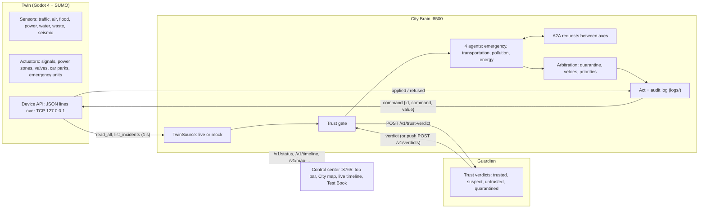

# Diagrams

- `architecture.mmd`: the three layers and how they talk (Mermaid source; GitHub renders it below).
- The text version of the same diagram, with the protocol details, is at the top of [../../INTEGRATION.md](../../INTEGRATION.md).

